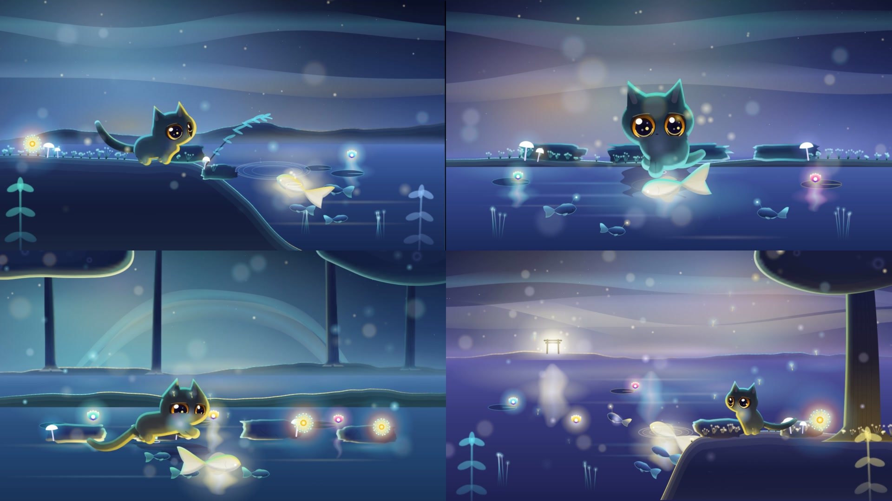

# Twilight Fable · 暮光柔焦绘本

> 大光圈奶油散景 · 双层法线边缘光 · 120Hz 弹簧骨架生灵 · 可生成的地形、水与室内
> 一个风格，一个仓库：HTML-in-Canvas 多场景 + Canvas2D 绘本舞台 + WebGL2 颗粒 pass + 确定性渲染 + 程序化配乐。  
> Created by **Star Dinosaur (星星恐龙)** · MIT



本仓库从 [`stardino-stylehop`](https://github.com/star-dino/stardino-stylehop) 的 `bdf4dfb` 拆出，只保留 `twilight-fable` 一个风格及其运行时依赖，删去了其他风格与多风格框架的残余。默认样片《暖窗 · The Warm Window》共 4 个场景、14 秒，由 `styles/twilight-fable/world.js` + `scenes.html` 组成。

## 它是什么

- **kernel（工具箱）**：`styles/twilight-fable/kernel.js` 提供可生成的场地（地表轮廓、石头、树干、树冠、池塘、溪流、窗、光柱、雾）、8 种内置 look（外加自定义 look）以及参数化生灵（物种 × 体型 × 侧/3q/正/背视角）。没有默认摆放，每个元素都必须带坐标。
- **world（一个例子）**：`styles/twilight-fable/world.js` 是一个具体故事，不是模板。
- **规格**：`styles/twilight-fable/SPEC.md`（去固化铁律、API、look 预设、生灵体型）。
- **声音**：`tools/sound.py` 的 `twilight` 预设（Celesta 钟片模态合成 + 毡面钢琴和弦 + 大提琴 + 柔和拟音，如 `paw_step`、`critter_hop`、`water_ripple`），全部纯 Python（NumPy + SciPy）。

## 快速开始

```bash
npm install                      # 仅依赖 playwright-core
# 需要 Chrome 157+（151–154 走 legacy 兼容路径）；用 CHROME_BIN 或 PLAYWRIGHT_CHROME 指定可执行文件，
# 否则自动探测 ~/.cache/ms-playwright/chromium-*/chrome-linux64/chrome
# 声音与成片还需要 python3（numpy、scipy）与 ffmpeg

npm run serve                    # Studio：http://127.0.0.1:8080/gallery/

# 体检：运行时报错、文字越界、字号、停留时长、浮层遮挡（默认 16:9 与 9:16）
node tools/audit.mjs --style twilight-fable

# 渲染 2×2 检视表（务必显式指定 --sheet，产物放在仓库外的 ../out/ 下）
node tools/render.mjs --style twilight-fable --sheet ../out/scratch/2026-11-04-demo/sheet.jpg

# 渲染成片（逐帧截图 + 程序化配乐 + loudnorm）
node tools/render.mjs --style twilight-fable --video ../out/scratch/2026-11-04-demo/twilight-fable.mp4 --fps 30 --workers 4

# 画面回归：与 styles/twilight-fable/look_baseline.* 对比，有意改动后 --accept
python3 tools/lookcheck.py --style twilight-fable

# 可选：人声轨（TTS 是构建步骤，默认关闭；依赖见 requirements-voice.txt）
node tools/render.mjs --style twilight-fable --video <out>.mp4 --voice <dir>/voice.json
```

产物一律写到仓库外的 `../out/`（`STYLEHOP_OUT` 可改写）；仓库内不放输出，`.gitignore` 兜底忽略 `/out`。

## 目录

```text
engine/     运行时：stage.js · motion.js · studio2d.js · critter2d.js · html_in_canvas.js · passes/grain.js · base.css …（见 engine/README.md）
gallery/    Studio（index.html + player.html + catalog.js，只列 twilight-fable）
styles/twilight-fable/
            style.js · kernel.js · world.js · scenes.html · theme.css · SPEC.md · contact_sheet.jpg · look_baseline.{jpg,json}
tools/      audit.mjs · render.mjs · lookcheck.py · sound.py · audio_grains.py · voice.py · factcheck.mjs
```

声音颗粒 `assets/audio/*.wav` 由 `tools/audio_grains.py` 在首次合成时自动生成（被 `.gitignore` 忽略，不入库）。

## 与原仓库的差异

- 删除：其余风格（`ink-wash`、`clay-macaron`、`calibration-lab`、`vintage-naturalist`、模板）、3D 栈（`studio3d`、`director`、`look`、`gtao`、`puppet*`、`camera`、`three_bridge`、`vendor/three.min.js`）、其他 pass、纹理与 `textures.py`、录音采样叠加（`samples.py`）、`lookcheck --gates` / `render --pair` / `--shots-dir` 等 3D 机械风格门禁。
- 保留：twilight 全部代码路径。配乐在真实样片的 cue 单上与原仓库逐字节一致。
- 行为变化：`gallery/player.html` 不再探测 `styles/<id>/ref.json`（原先在没有该文件时产生一次 404，使 `audit.mjs` 失败）。
- 代码注释里偶见 `ADR-0xx` 编号，指向原作者的私有设计记录，本仓库不含这些文档。

## 许可

MIT，见 [`LICENSE`](LICENSE)；第三方声明见 [`CREDITS.md`](CREDITS.md) 与 [`LICENSE-THIRD-PARTY`](LICENSE-THIRD-PARTY)。
